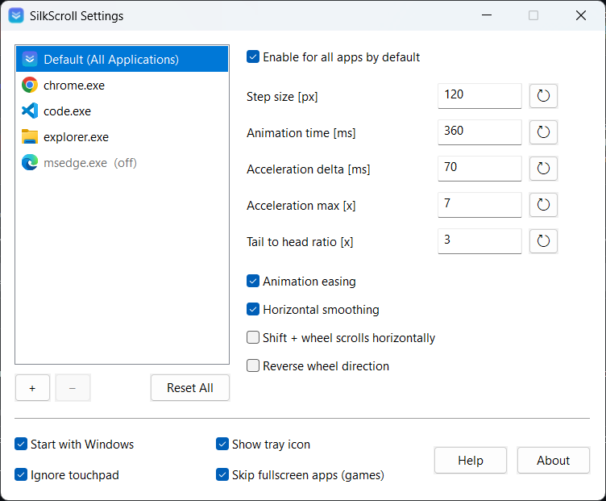
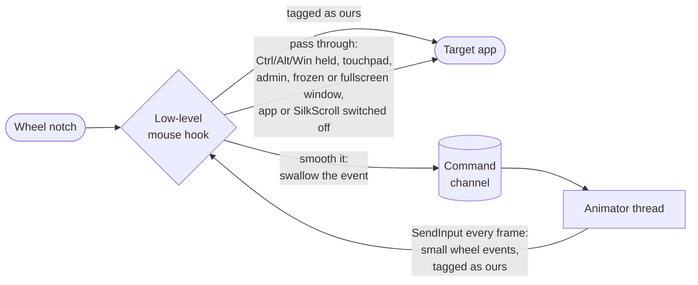
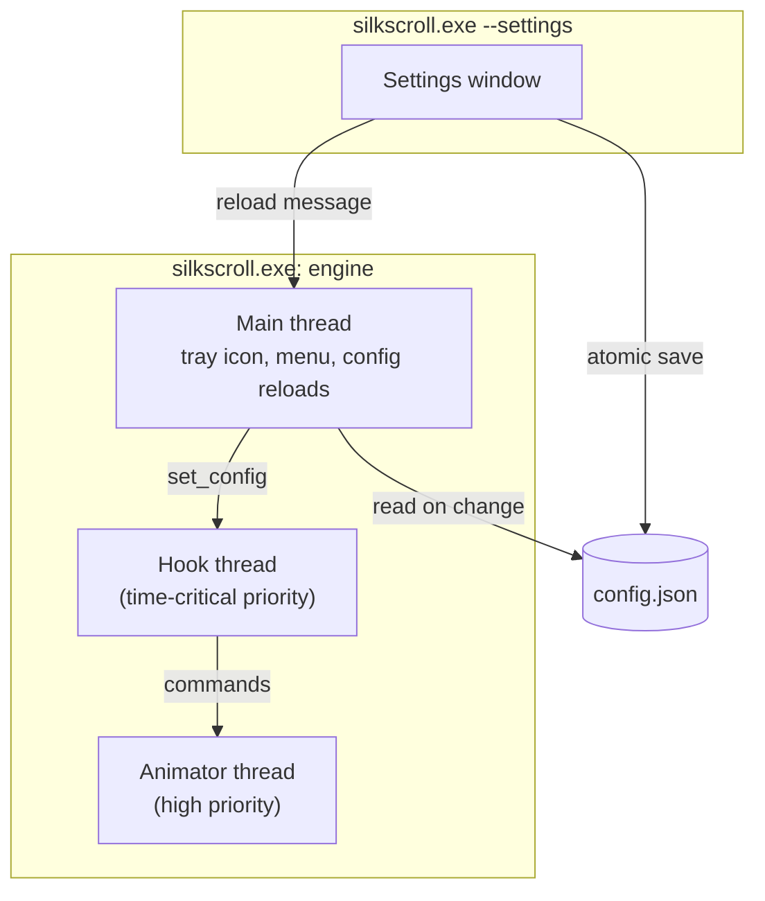

# SilkScroll

[](https://github.com/Amitk2108/silkscroll/actions/workflows/ci.yml)
[](https://github.com/Amitk2108/silkscroll/releases/latest)
[](https://github.com/Amitk2108/silkscroll/releases)
[](LICENSE)


**Smooth scrolling for every Windows app.** SilkScroll turns each notch of your mouse wheel into a short, eased
glide, in your browser, editor, File Explorer, Office and almost everything else, with optional per-app tuning.

Free and open source (MIT). One small `.exe`, no installer, no runtime, no telemetry, no network access.



---

## Contents

- [Features](#features)
- [Install](#install)
- [Using SilkScroll](#using-silkscroll)
- [Settings reference](#settings-reference)
- [How it works](#how-it-works)
- [Configuration file](#configuration-file)
- [Build from source](#build-from-source)
- [Project layout](#project-layout)
- [Troubleshooting](#troubleshooting)
- [Uninstall](#uninstall)
- [Contributing](#contributing)
- [License and credits](#license-and-credits)

## Features

- **Smooth, eased scrolling** for vertical and horizontal wheels, animated at your display's refresh rate.
- **Acceleration:** spin the wheel quickly to cover long pages faster, up to a limit you choose.
- **Per-app profiles:** give any app its own step size, speed and easing, or switch smoothing off just for it.
- **Tray menu shortcuts:** *Disable for <current app>* and *Disable for All Apps* in one click.
- **Shift + wheel scrolls sideways**, even in apps that don't support it themselves (optional).
- **Reverse wheel direction** (optional).
- **Leaves alone what it should:** touchpads and high-resolution wheels, Ctrl/Alt/Win + wheel (zoom and
  shortcuts), frozen windows, apps running as administrator, and borderless fullscreen games.
- **Start with Windows** without an installer.
- **Native and light:** standard Windows controls, per-monitor DPI aware, about 1 MB on disk and around 10 MB of
  memory, with no CPU use while you aren't scrolling.

## Install

### Download

1. Download `silkscroll.exe` from the [latest release](https://github.com/Amitk2108/silkscroll/releases/latest).
2. Put it somewhere permanent, for example `C:\Users\<you>\Apps\SilkScroll\silkscroll.exe`.
3. Double-click it. The settings window opens the first time, and a tray icon appears.
4. SilkScroll starts with Windows by default. Untick **Start with Windows** if you'd rather start it yourself.

Windows SmartScreen may warn about an unrecognized app because release builds are not code-signed. Choose
**More info → Run anyway**, or [build it yourself](#build-from-source).

> Running another smooth-scrolling tool at the same time (for example a mouse vendor's "smooth scrolling" option
> or another scrolling utility) makes the two fight over the same wheel events. Turn the other one off first.

### Requirements

- Windows 10 or Windows 11 (64-bit).
- No administrator rights needed.

## Using SilkScroll

| Action | What happens |
|---|---|
| Run `silkscroll.exe` | Starts SilkScroll in the tray. If it is already running, opens the settings window. |
| Left-click the tray icon | Opens the settings window. |
| Right-click the tray icon | Opens the menu (below). |

**Tray menu**

| Item | Effect |
|---|---|
| **Settings** | Opens the settings window. |
| **Disable for *app.exe*** | Turns smoothing off (or back on) for the app you were last using. |
| **Disable for All Apps** | Master switch. The tray icon turns grey while SilkScroll is off. |
| **Start with Windows** | Adds or removes SilkScroll from your sign-in startup apps. |
| **Open Settings Folder** | Opens `%APPDATA%\SilkScroll`. |
| **About SilkScroll** / **Exit** | Version info / quit SilkScroll. |

**Settings window**

- The list on the left holds **Default (All Applications)** and one entry per app with its own profile. Apps
  that are switched off are shown greyed out with *(off)*.
- **+** adds an app, either from a list of apps that currently have a window open or by browsing for its
  `.exe`. A new app starts as a copy of the defaults. **–** removes the selected app's profile, so it follows the
  defaults again. **Reset All** resets every value of the selected profile.
- The **⟲** button next to each value resets just that value: to the factory default for the default profile, or
  to the current default for an app profile.
- Hover over any setting for an explanation.
- There is no Save button: every change is saved and applied immediately.

**Command line**

```text
silkscroll.exe              start (or open settings if already running)
silkscroll.exe --settings   open the settings window
silkscroll.exe --quit       ask a running SilkScroll to exit
```

## Settings reference

Per-profile settings (the defaults, and each app's own copy):

| Setting | Config key | Default | Range | Meaning |
|---|---|---|---|---|
| Enable | `enabled` | on | | Smooth scrolling for this profile. |
| Step size [px] | `step_size_px` | 120 | 10 – 1000 | Distance of one notch. 100 is one normal notch in a browser, so the default scrolls a little further per notch. |
| Animation time [ms] | `animation_time_ms` | 360 | 50 – 2000 | How long each notch keeps gliding. |
| Acceleration delta [ms] | `acceleration_delta_ms` | 70 | 0 – 500 | Notches arriving closer together than this speed scrolling up. 0 turns acceleration off. |
| Acceleration max [x] | `acceleration_max` | 7 | 1 – 20 | Upper limit for that speed-up, as a multiple of the step size. 1 turns it off. |
| Animation easing | `easing` | `pulse` | `pulse`, `ease_out`, `linear` | The shape of the glide. The checkbox switches between `pulse` and `linear`; `ease_out` can be set in the config file. |
| Tail to head ratio [x] | `tail_to_head_ratio` | 3 | 1 – 20 | Pulse easing only: how much longer the slow-down lasts than the speed-up. |
| Horizontal smoothing | `horizontal_smoothing` | on | | Also smooth tilt-wheel and horizontal-wheel scrolling. |
| Shift + wheel scrolls horizontally | `shift_for_horizontal` | off | | Turn Shift + wheel into sideways scrolling. |
| Reverse wheel direction | `reverse_direction` | off | | Up becomes down, left becomes right. |

Global settings:

| Setting | Config key | Default | Meaning |
|---|---|---|---|
| Disable for All Apps (tray) | `enabled` | on | Master switch. |
| Start with Windows | `start_with_windows` | on | Run at sign-in (adds a value under `HKCU\...\CurrentVersion\Run`). Off by default in debug builds. |
| Show tray icon | `show_tray_icon` | on | When hidden, run `silkscroll.exe` again to reach the settings. |
| Ignore touchpad | `ignore_touchpad` | on | Leave touchpads and free-spinning high-resolution wheels alone; they already scroll smoothly. |
| Skip fullscreen apps (games) | `skip_fullscreen_apps` | on | Don't smooth inside borderless fullscreen windows, which are mostly games. |

## How it works

### The path of one wheel notch



1. **Catch.** A `WH_MOUSE_LL` hook (`src/engine.rs`) sees every wheel event on the desktop before any app does.
2. **Decide.** For each event the hook looks at the window under the pointer and its process (`src/target.rs`),
   then picks that app's profile, or the defaults, from the config. It lets the event through untouched when any
   of the pass-through rules above applies.
3. **Swallow and queue.** Otherwise the hook returns `1`, so the app never sees the original notch, and sends the
   distance to the animator thread.
4. **Animate.** The animator (`src/animator.rs`) turns each notch into a *glide*: a distance released over
   `animation_time_ms` along the easing curve (`src/easing.rs`). Glides overlap when you keep spinning, notches
   that arrive quickly are multiplied by the acceleration factor, and turning the wheel the other way cancels the
   glide in flight.
5. **Replay.** Once per display frame the animator sums how far all glides moved and injects that many wheel units
   with `SendInput`. Fractions are carried to the next frame, so a notch always adds up to exactly its distance.
   Injected events carry a marker (`dwExtraInfo = "SILK"`), so the hook lets them through.

Apps that follow Windows' guidelines for high-resolution wheels (browsers, Electron apps, Office, File Explorer and
most modern software) scroll smoothly with these small deltas. Old apps that treat every wheel message as a full
notch may scroll too fast; switch SilkScroll off for those apps with a profile or from the tray.

### Processes and threads



- The engine and the settings window are the **same exe** in two modes, kept to one instance each by named
  mutexes (`src/instance.rs`). The settings window runs as a separate process, so the hook thread is never slowed
  down by UI work.
- The **config file is the only thing they share.** The settings window writes it atomically (temp file +
  rename), then pings the engine's tray window, which reloads it. The engine also checks the file's modification
  time every 500 ms, so edits made by hand are picked up too.
- Windows silently removes a low-level hook that ever answers too slowly. The engine re-installs it every five
  minutes and after the session is unlocked or the PC resumes.

For the details (the glide math, the acceleration formula, why some windows are skipped), see
[docs/ARCHITECTURE.md](docs/ARCHITECTURE.md).

## Configuration file

Settings live in `%APPDATA%\SilkScroll\config.json`. You normally change them in the settings window, but the
file is plain JSON and safe to edit by hand: missing keys use their defaults, out-of-range values are clamped,
and a running SilkScroll picks up the change within half a second. If the file can't be parsed at startup it is
renamed to `config.bad.json` and the defaults are used.

```json
{
  "enabled": true,
  "start_with_windows": true,
  "show_tray_icon": true,
  "ignore_touchpad": true,
  "skip_fullscreen_apps": true,
  "defaults": {
    "enabled": true,
    "step_size_px": 120.0,
    "animation_time_ms": 360.0,
    "acceleration_delta_ms": 70.0,
    "acceleration_max": 7.0,
    "easing": "pulse",
    "tail_to_head_ratio": 3.0,
    "horizontal_smoothing": true,
    "shift_for_horizontal": false,
    "reverse_direction": false
  },
  "apps": {
    "code.exe": { "step_size_px": 80.0, "animation_time_ms": 300.0 },
    "javaw.exe": { "enabled": false }
  },
  "app_paths": {
    "code.exe": "C:\\Users\\you\\AppData\\Local\\Programs\\Microsoft VS Code\\Code.exe"
  }
}
```

App keys are lowercase exe file names. `app_paths` is only used to show each app's icon in the settings window.

## Build from source

### Prerequisites

| Tool | Why | Get it |
|---|---|---|
| Windows 10/11, 64-bit | SilkScroll uses Win32 APIs only | |
| Rust 1.85 or newer (MSVC toolchain) | compiler | [rustup.rs](https://rustup.rs), then `rustup default stable-x86_64-pc-windows-msvc` |
| Visual Studio Build Tools 2019 or newer with **Desktop development with C++** | the MSVC linker (`link.exe`) and the Windows SDK, whose `rc.exe` embeds the icon and manifest | [visualstudio.microsoft.com/downloads](https://visualstudio.microsoft.com/downloads/) → *Build Tools for Visual Studio* |
| Git | to clone | [git-scm.com](https://git-scm.com) |

### Build

```powershell
git clone https://github.com/Amitk2108/silkscroll.git
cd silkscroll
cargo build --release
```

The app is written to `target\release\silkscroll.exe`. It is self-contained; copy it anywhere.

### Check your changes

These are the same checks CI runs on every pull request:

```powershell
cargo fmt --check                          # formatting
cargo clippy --all-targets -- -D warnings  # lints, warnings are errors
cargo test                                 # unit tests (scroll math, easing, config, icon)
```

### See the smoothing for yourself: the wheel probe

`examples/wheel_probe.rs` opens a small window that counts every wheel event it receives. It can also simulate
wheel notches for you (it moves the mouse pointer into its window to do so):

```powershell
cargo run --release --example wheel_probe -- --inject 1 --seconds 2
```

| SilkScroll | Typical output |
|---|---|
| not running | `events=1 total_delta=120` (one plain notch) |
| running, default settings | dozens of small events adding up to `total_delta=144` over about 0.36 s (step size 120 is 1.2 plain notches) |

Without `--inject` the probe just listens for 10 seconds while you scroll over it yourself.

## Project layout

```text
silkscroll/
├── src/
│   ├── main.rs        entry point: engine, --settings or --quit
│   ├── engine.rs      low-level mouse hook, animator thread, SendInput
│   ├── animator.rs    glide math and acceleration (pure Rust, unit tested)
│   ├── easing.rs      easing curves (pure Rust, unit tested)
│   ├── config.rs      settings model, JSON load/save, limits (unit tested)
│   ├── target.rs      window and process lookups: exe name, elevation, fullscreen
│   ├── tray.rs        tray icon, tray menu, config reloads, hook watchdog
│   ├── settings.rs    the settings window (native Win32 controls)
│   ├── autostart.rs   "Start with Windows" registry value
│   ├── instance.rs    single-instance mutexes and messages between processes
│   ├── icon.rs        the app icon, drawn in code (also used by build.rs)
│   └── win.rs         small Win32 helpers
├── examples/
│   └── wheel_probe.rs diagnostic window that counts wheel events
├── res/
│   └── silkscroll.manifest  common controls v6, per-monitor DPI, asInvoker
├── build.rs           renders the .ico and embeds icon + manifest into the exe
├── docs/              architecture notes and screenshots
└── .github/           CI, release workflow, issue and PR templates
```

The rule of thumb: **logic that can be tested without Windows lives in `animator.rs`, `easing.rs` and
`config.rs`**, and everything that calls Win32 is kept in the other modules.

## Troubleshooting

**Scrolling isn't smooth in one app.**
- Is the app running as administrator? Windows doesn't let a normal app send input to an elevated one, so
  SilkScroll leaves those windows alone. Run SilkScroll as administrator too if you need it there.
- Is it fullscreen? Untick **Skip fullscreen apps (games)**.
- Are you using a touchpad or a free-spinning high-resolution wheel? Those are left alone while **Ignore
  touchpad** is ticked.
- Check that the app isn't listed as *(off)* in the settings window.

**An app scrolls much too fast or jumps.** It probably treats every wheel message as a whole notch. Add it with
**+** and untick **Enable for this app**, or use **Disable for *app.exe*** in the tray menu.

**A game reacts strangely to the wheel.** Leave **Skip fullscreen apps (games)** ticked, or disable SilkScroll
for the game's exe.

**Scrolling feels doubled or wobbly.** Another smoothing tool is running at the same time, such as a mouse
driver's smooth-scrolling option or another scrolling utility. Use only one.

**My antivirus flags SilkScroll.** Global mouse hooks plus `SendInput` are also what some malware uses, so
heuristic scanners sometimes flag tools like this. The full source is here; build it yourself if you prefer.

**Ctrl + wheel doesn't zoom smoothly.** That's intentional: Ctrl, Alt and Win + wheel are passed through
unchanged so zoom and other shortcuts behave exactly as before.

## Uninstall

1. Right-click the tray icon and untick **Start with Windows**, then choose **Exit**.
2. Delete `silkscroll.exe`.
3. Optionally delete your settings folder: `%APPDATA%\SilkScroll`.

SilkScroll writes nothing else to your system.

## Contributing

Contributions are welcome: bug reports, app compatibility notes, docs, and code. Start with
[CONTRIBUTING.md](CONTRIBUTING.md), which covers the development setup, coding conventions, how to add a new
setting, and the release process. Please follow the [Code of Conduct](CODE_OF_CONDUCT.md), and report security
issues as described in [SECURITY.md](SECURITY.md).

## License and credits

SilkScroll is released under the [MIT License](LICENSE).

The *Pulse* easing curve follows the "pulse" (viscous fluid) response by Michael Herf, as popularized by the
MIT-licensed `smoothscroll.js`. See [THIRD_PARTY_NOTICES.md](THIRD_PARTY_NOTICES.md).

SilkScroll is an independent project written from scratch. It is not affiliated with any commercial
smooth-scrolling product.
