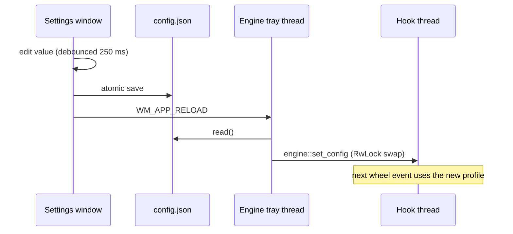

# SilkScroll architecture

This document explains how SilkScroll works internally, for contributors who want to change the engine. For a
shorter overview, see [How it works](../README.md#how-it-works) in the README.

## Design goals

1. **Never make the mouse feel worse.** The hook sits in the path of every mouse event on the desktop, so it must
   be fast and must fail open: when in doubt, let the original event through.
2. **Exact distances.** A notch must travel exactly as far as configured, however it is split into frames.
3. **No surprises for other software.** Pass through anything that isn't plain wheel scrolling: zoom shortcuts,
   touchpads, games, apps that can't receive injected input.
4. **Small and dependency-light.** Plain Win32 through `windows-sys`, `serde` for the config, nothing else at
   runtime.

## Processes

`silkscroll.exe` runs in one of two modes:

| Mode | Started by | Single-instance mutex | Window class |
|---|---|---|---|
| Engine (no arguments) | the user, or the Run key at sign-in | `Local\SilkScroll.Engine` | `SilkScroll.Tray` (hidden) |
| Settings (`--settings`) | the tray, or a second launch of the engine | `Local\SilkScroll.Settings` | `SilkScroll.Settings` |

- Launching the engine while the **same exe** is already running opens the settings window instead (`main.rs`).
- Launching the engine while a **different exe** is running (an older version in another folder, or a download
  saved under another name) replaces it: the new process closes the old engine and settings window, waits for
  them to exit, then takes over (`instance::engine_is_other_copy`, `instance::quit_all`).
- Opening the settings while the engine isn't running starts the engine (`settings::run`).
- `--quit` posts `WM_APP_QUIT` to the hidden tray window, closes the settings window and waits until both have
  exited. The installer does the same from its own code (`StopSilkScroll` in `installer/silkscroll.iss`) before it
  replaces or removes the exe.

The settings UI runs as a separate process so it can never stall the hook thread, and a crash in the UI can't
take scrolling down with it.

## Engine threads

| Thread | Priority | Job |
|---|---|---|
| main | normal | Hidden tray window: tray icon, menu, config polling, hook watchdog |
| `mouse-hook` | time critical | Owns the `WH_MOUSE_LL` hook and pumps its message loop |
| `animator` | highest | Turns commands into frames of `SendInput` |

### The hook (`engine.rs`)

`hook_proc` runs for every mouse event system-wide, so it only reacts to `WM_MOUSEWHEEL` and `WM_MOUSEHWHEEL`
events whose `dwExtraInfo` is not SilkScroll's own marker (`0x5349_4C4B`, "SILK"). `intercept` then applies the
pass-through rules in order, cheapest first:

1. SilkScroll switched off.
2. Delta not a multiple of 120 while *Ignore touchpad* is on: touchpads and free-spinning wheels report fractions
   of a notch and are already smooth.
3. Ctrl, Alt or a Win key held: zoom and other shortcuts.
4. No window under the pointer, or the window is hung (`IsHungAppWindow`).
5. The target process can't receive our input. With UIPI (User Interface Privilege Isolation), a non-elevated
   process can't send input to an elevated one, and `SendInput` fails silently, so swallowing the event would make
   the wheel go dead. `target::app_info` checks the token elevation of both processes.
6. A borderless window covering its whole monitor while *Skip fullscreen apps* is on.
7. The app's profile (or the defaults) is disabled.

If none applies, the hook converts the delta into wheel units (`animator::units_for`), applies
*Shift for horizontal* and *Reverse direction*, sends a `Command::Scroll` to the animator and returns `1` to swallow
the event.

Process lookups (`OpenProcess`, `QueryFullProcessImageNameW`, token query) are cached per PID for five seconds in
`target::AppCache`, so a burst of wheel events costs one lookup.

The hook body runs inside `catch_unwind`: a panic must never unwind across the `extern "system"` boundary, and if
anything goes wrong the event is simply passed through.

**Watchdog.** Windows silently removes a low-level hook whose callback once exceeds `LowLevelHooksTimeout`, for
example while the PC is swapping heavily. Because there is no notification, the tray re-installs the hook every
five minutes and after `WTS_SESSION_UNLOCK` and `PBT_APMRESUMEAUTOMATIC`.

### The animator (`animator.rs`, `engine.rs`)

The animator thread sleeps on the command channel while nothing is moving, so it uses no CPU when idle. While a
glide is active it wakes once per frame of the primary display (60–360 Hz, read from `EnumDisplaySettingsW`)
using a high-resolution waitable timer.

Each axis has an `AxisAnimator` holding a list of **glides**:

```text
glide = { distance, released, start_ms, duration_ms, easing, tail_ratio }
```

On every frame:

```text
moved = carry
for each glide:
    t        = clamp((now - start) / duration, 0, 1)
    position = distance * easing(t)
    moved   += position - released
    released = position
    drop the glide when t == 1
emit  = trunc(moved)        (round(moved) once every glide has finished)
carry = moved - emit
```

Carrying the fraction, and rounding only at the very end, guarantees the injected deltas add up to the exact
distance. The unit tests check this for every easing curve and for odd frame rates.

**Acceleration.** When a notch arrives `gap` ms after the previous one and `gap < acceleration_delta_ms`:

```text
factor = clamp((1 + acceleration_delta_ms / gap) / 2, 1, acceleration_max)
```

The factor is 1 at the edge of the window, 2 when notches come twice as fast, and is capped by
`acceleration_max`.

**Direction change.** A notch in the opposite direction clears all glides on that axis, so reversing the wheel
stops at once instead of fighting the momentum.

**Units.** Windows reports 120 units per notch. Step size is expressed in "browser pixels", where 100 px is one
notch, so `units = notches * step_size_px * 1.2`.

### Easing (`easing.rs`)

All curves map `t` in `[0, 1]` to `[0, 1]`, start at 0, end at exactly 1 and never decrease (tested).

- **Pulse:** an exponential push followed by an exponential decay, normalized to end at 1. Time is scaled by
  `tail_to_head_ratio`, so the push takes the first `1 / ratio` of the animation and the glide the rest.
- **Ease-out:** `1 - (1 - t)^3`.
- **Linear:** `t`.

## Configuration and reloads (`config.rs`)

- `Config` and `Profile` derive serde with `#[serde(default)]`, so missing keys fall back to defaults and older
  config files keep working when settings are added.
- `sanitized()` clamps every number into the `LIMITS_*` ranges and lowercases app keys. This runs on every load,
  so a hand-edited file can't produce a runaway scroll.
- `save()` writes `config.json.tmp` and renames it over `config.json`, so readers never see a half-written file.
- `read()` returns an error for a missing or invalid file and changes nothing. Live reloads use it: if the user is
  halfway through saving the file from an editor, the running settings stay until the next valid save.
- `load()` is used at startup: it retries an invalid file briefly, then moves it to `config.bad.json` and starts
  from defaults.
- **Upgrades.** `config_version` records the file format. A file from an older version (missing or lower
  `config_version`) whose default profile still equals one of the `PREVIOUS_DEFAULTS` was never customized, so
  its defaults are replaced with the current ones. Customized defaults and app profiles are left alone. `load()`
  saves the upgraded file once.

Flow of a change made in the settings window:



Changes made from the tray menu go the other way: the tray saves the file, and the settings window, which checks
the file's modification time every second, reloads its controls.

## Settings window (`settings.rs`)

- Plain Win32 controls (`LISTBOX`, `BUTTON`, `EDIT`, `STATIC`) with the common controls v6 manifest, so they get
  the native Windows look.
- Laid out on a 96-DPI grid and scaled by `GetDpiForWindow`. On `WM_DPICHANGED`, fonts are recreated and every
  control is repositioned.
- The app list is owner-drawn (`LBS_OWNERDRAWFIXED`) to show each app's icon (`SHGetFileInfoW`) and to grey out
  disabled apps.
- Window state lives in a `thread_local! RefCell`. Win32 often sends notifications synchronously while we are
  changing a control (for example `EN_CHANGE` from `SetWindowTextW`). `with_state` uses `try_borrow_mut`, so those
  re-entrant notifications are skipped instead of panicking. Code that shows a dialog or a menu (which pump
  messages) never holds the borrow.

## Adding a feature: where things go

| Change | Files |
|---|---|
| New per-app setting | `config.rs` (field, default, limits, test) → `engine.rs` (use it) → `settings.rs` (control + tooltip) → README settings table |
| New pass-through rule | `engine.rs::intercept` (and `target.rs` if it needs window or process info) |
| New easing curve | `easing.rs` (variant + tests) → mention in README |
| Tray menu item | `tray.rs` (`build_menu`, `on_menu`) |
